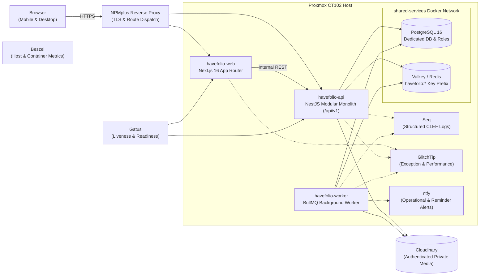

# Havefolio

> **Shop your own home first.** A private, mobile-first personal inventory and anti-consumerism decision aid.

Havefolio helps people buy more intentionally by showing them what they already own, what they have spent, and what else a planned purchase could fund. It turns your belongings into an enjoyable, searchable personal storefront ("My Store") while providing thoughtful friction before new purchases through waiting periods, owned-item comparisons, and concrete savings goals.

---

## Core Principles & Product Invariants

Havefolio is built on non-negotiable principles defined in [`anti-consumerism-app-build-prompt.md`](./anti-consumerism-app-build-prompt.md) and [`AGENTS.md`](./AGENTS.md):

- **Shop Your Own Home:** Not a marketplace, checkout, or shopping affiliate app. Its products are the possessions you already own.
- **Manual Entry First:** Manual item entry must always work. External enrichment (barcodes, URLs, OCR) may assist but never blocks entry or overwrites user facts.
- **Warm & Neutral:** Never shames users for purchases or labels their choices for them. Need, Want, and Greed classifications are descriptive and self-selected.
- **Exact Money:** Stored as integer minor units with explicit ISO 4217 currencies (e.g., INR, USD). Never uses floating-point money or silent historical currency conversions.
- **Date Precision:** Preserves exact, month-only, year-only, and unknown purchase date precision without inventing days.
- **True Spending:** Categorizes spending by actual purchase price paid. Separates currently-owned inventory from historical spending (items sold, donated, or disposed of). Unknown prices are excluded from sums while keeping item counts visible. Gifts do not count toward spending unless the owner recorded an amount paid.
- **Decision Integrity:** Avoided spend from postponed or declined desires is an estimate; it only becomes actual savings when explicitly allocated to a personal goal.
- **Explainable Matching:** Similar-item matches explain why they matched, and can be easily dismissed or corrected.
- **Privacy by Default:** Private single-owner household model. Photos, receipts, documents, and inventory data require authenticated access and are never public.

---

## Architecture Overview

Havefolio is designed as a TypeScript modular monolith deployed as lightweight Docker containers on Proxmox CT102 behind an NPMplus TLS reverse proxy.



For complete architectural decisions and non-functional targets, see [`docs/architecture/README.md`](./docs/architecture/README.md).

---

## Monorepo Structure

Havefolio is organized as a [`pnpm`](https://pnpm.io/) workspace containing applications (`apps/`) and shared packages (`packages/`):

```text
havefolio/
├── apps/
│   ├── api/             # NestJS modular monolith REST API (/api/v1)
│   ├── web/             # Next.js 16 App Router web frontend (React 19, Tailwind CSS)
│   └── worker/          # BullMQ background worker for reminders and media processing
├── packages/
│   ├── config/          # Shared ESLint, Prettier, and TypeScript configurations
│   ├── contracts/       # OpenAPI baseline (openapi.json), DTOs, and compatibility checker
│   ├── db/              # Drizzle ORM schema, migrations, connection pools, and RLS policies
│   ├── domain/          # Pure domain models (Money, ApproximateDate, financial calculations)
│   ├── logging/         # Structured logging (Pino, Seq CLEF ingestion, correlation IDs)
│   ├── monitoring/      # GlitchTip/Sentry error tracking and Gatus health checks
│   ├── test-utils/      # Ephemeral PostgreSQL/Valkey test harness and fixture factories
│   └── ui/              # Shared UI component primitives (shadcn/ui, Kibo UI)
├── docs/                # Architecture decisions, operational runbooks, and domain specs
├── scripts/             # Infrastructure verification, proxy tests, and monitoring scripts
├── anti-consumerism-app-build-prompt.md # Canonical product requirements brief
└── AGENTS.md            # Canonical contributor & AI agent workflow instructions
```

---

## Tech Stack

| Layer | Technologies |
| :--- | :--- |
| **Frontend** | [Next.js 16](https://nextjs.org/) (App Router), [React 19](https://react.dev/), [TypeScript](https://www.typescriptlang.org/), [Tailwind CSS](https://tailwindcss.com/), [shadcn/ui](https://ui.shadcn.com/), [Kibo UI](https://kibo-ui.com/) |
| **Backend** | [NestJS 11](https://nestjs.com/) (Modular Monolith), [Express](https://expressjs.com/), [OpenAPI / Swagger](https://swagger.io/) |
| **Database & ORM** | [PostgreSQL 16](https://www.postgresql.org/), [Drizzle ORM](https://orm.drizzle.team/), Row-Level Security (RLS) |
| **Queue & Cache** | [Valkey](https://valkey.io/) / [Redis](https://redis.io/), [BullMQ](https://bullmq.io/) |
| **Authentication** | Secure HttpOnly cookies, Argon2id password hashing, single-owner model |
| **Media Storage** | Cloudinary authenticated storage adapter (pluggable S3-compatible adapter) |
| **Observability** | [Seq](https://datalust.co/seq) (Structured logging), [GlitchTip](https://glitchtip.com/) (Error tracking), [Gatus](https://gatus.io/) (Health/uptime), [ntfy](https://ntfy.sh/) (Alerts) |
| **Deployment** | [Docker](https://www.docker.com/), [Proxmox](https://www.proxmox.com/) CT102, [NPMplus](https://github.com/ZoeyVid/NPMplus) |

---

## Prerequisites

Ensure you have the following installed locally:

- **Node.js**: `>= 24.0.0`
- **pnpm**: `>= 12.8.0`
- **Docker**: For running PostgreSQL, Valkey, and isolated test containers
- **Python**: `3.x` (for infrastructure verification scripts in `scripts/`)

---

## Quickstart & Local Setup

### 1. Clone the Repository

```sh
git clone https://github.com/Harsh71019/havefolio.git
cd havefolio
```

### 2. Configure Environment Variables

Copy the example configuration to `.env.local`:

```sh
cp .env.example .env.local
```

> [!IMPORTANT]
> Never commit `.env.local` or print secrets. Edit `.env.local` to configure your database connection, Valkey credentials, and test credentials.

### 3. Install Dependencies and Build Shared Packages

```sh
pnpm install
pnpm build:packages
```

### 4. Run Database Migrations

Apply database migrations to your development PostgreSQL database:

```sh
pnpm db:migrate
```

### 5. Start the Development Server

Start the web application, API, and worker concurrently:

```sh
pnpm dev
```

- **Web:** [http://localhost:3000](http://localhost:3000)
- **API:** [http://localhost:3001/api/v1](http://localhost:3001/api/v1)
- **API Swagger Documentation:** [http://localhost:3001/api/v1/docs](http://localhost:3001/api/v1/docs) (when `API_DOCS_ENABLED=true`)

---

## Verification & Testing Gates

Havefolio enforces strict baseline verification gates. All gates must pass prior to opening a pull request:

```sh
# Run all repository baseline gates (lint, formatting, typecheck, unit tests, build)
pnpm check

# Run integration test suites against isolated test PostgreSQL and Valkey
pnpm test:integration

# Run smoke and production proxy tests
pnpm test:smoke

# Verify Drizzle migrations against committed schema snapshots
MIGRATION_BASE_REF=origin/main pnpm db:check
```

### Additional Focused Commands

```sh
# Run domain financial & boundary unit tests
pnpm --filter @havefolio/domain test

# Run OpenAPI compatibility checking tests
pnpm --filter @havefolio/contracts test

# Run API integration tests only
pnpm --filter @havefolio/api test:integration

# Run format check or apply code formatting
pnpm format:check
pnpm format
```

---

## Ticket-First Contribution Workflow

All contributors and AI agents must follow the canonical rules defined in [`AGENTS.md`](./AGENTS.md):

1. **Kan Ticket Required:** Every branch and commit must map to a Kan ticket in the format `PER-<number>`.
2. **Clean Branching:** Branches must be cut from a clean, up-to-date `origin/main`:
   ```sh
   git fetch origin
   git switch main
   git pull --ff-only origin main
   ```
3. **Branch Naming:** Format: `<type>/PER-<number>-<short-kebab-description>`
   - Allowed types: `feat`, `fix`, `chore`, `docs`, `test`, `refactor`, `perf`, `build`, `ci`.
   - Example: `feat/PER-10-owned-item-crud`, `docs/PER-61-repository-readme`.
4. **Commit Messages:** Must include the ticket key with an imperative summary:
   ```text
   <type>(PER-<number>): <imperative summary>
   ```
   - Example: `docs(PER-61): add repository readme and developer quickstart`
5. **Pull Requests:** PR titles must begin with `PER-<number>: <imperative summary>`. All CI gates must be green before requesting Code Review.
6. **No Secret Leaks:** Never log, print, commit, or stage credentials, signed URLs, receipts, or `.env.local` contents.

---

## License

Private and proprietary. All rights reserved.

## Amazon product images (local CLI, PER-102)

Requires Node 24+, `pnpm install --frozen-lockfile`, and Google Chrome installed
on the Mac. Uses headed Chrome with a dedicated persistent profile at
`~/.havefolio-scraper-profile`; it never uses your everyday Chrome profile.

```sh
# Extract/download only: no Havefolio credentials or writes.
npx tsx scripts/amazon-to-havefolio.ts 'https://www.amazon.in/dp/B07V78GMXS' --dry-run

# Upload to a specific existing item; preserve its title, purchase details and cover.
npx tsx scripts/amazon-to-havefolio.ts 'https://www.amazon.in/dp/B07V78GMXS' --item ITEM_UUID

# Reuse a unique ASIN match, or create from the Amazon title when no match exists.
npx tsx scripts/amazon-to-havefolio.ts 'https://www.amazon.in/dp/B07V78GMXS' --keep
```

For uploads, add `HAVEFOLIO_API_URL` and `HAVEFOLIO_TOKEN` to an ignored `.env`
(see `.env.example`). The token is the **value of your existing owner session
cookie**, available in Chrome DevTools → Application → Cookies after signing in;
it is not an Authorization/Bearer token. Do not paste it into CLI arguments,
screenshots or tickets. HTTPS defaults to `__Host-havefolio_session`; localhost
uses `havefolio_session`. Trusted LAN HTTP requires `HAVEFOLIO_ALLOW_HTTP=true`
and the app's existing LAN auth configuration; its cookie is
`havefolio_lan_session`. Havefolio credentials are sent only to the configured
Havefolio origin through a separate API request context, never to Amazon.

The CLI canonicalizes the Amazon URL, extracts the gallery's high-resolution
images (then landing-image/thumbnail fallbacks), excludes non-product media,
deduplicates image IDs, and downloads the first three valid images with the main
image first. Images must exceed 5 KiB, have a long edge of at least 500 pixels,
and fit the existing 24-megapixel/8192-pixel and 10 MiB upload limits. Downloads
are converted to JPEG with metadata stripped. Fewer available images produce a
warning. Amazon actions are delayed 1–3 seconds; network steps retry twice with
backoff. CAPTCHA/sign-in walls pause for you to clear them manually in Chrome,
then press Enter in the terminal. There is no challenge solver or bypass.

Without `--item`, the CLI reads bounded, paginated inventory details to match the
Amazon URL/ASIN across every ownership status. Multiple matches require an
explicit `--item`; no matching item creates one with unknown price, purchase
date, acquisition type, condition and usage, provisional Owned status, and the
configured `HAVEFOLIO_CURRENCY` (default INR). No Amazon catalogue price becomes
actual spending. Existing item names, prices, dates, URLs and specifications are
preserved; captured `Amazon title` and `Amazon ASIN` fields are merged into
specifications. A conflicting ASIN is rejected. No schema change is needed.

Photos use the existing `POST /api/v1/items/:id/photos` multipart `photos` field
with a stable UUID `Upload-Id` for each sequential file. The app supports JPEG,
PNG and WebP (10 MiB/file, 4 files/request, 21 MiB/request, 8 photos/item). Existing
photos and cover stay first; the new main image leads the appended group. The CLI
verifies saved photo IDs and order before declaring success. New items use the
existing stable `commandId` creation contract; the deployed API must support it.
No new backend endpoints or providers are introduced.

Downloads live in ignored `./tmp/<ASIN>/`. Dry-runs retain them; successful uploads
remove them unless `--keep` is supplied. Failures retain a screenshot, page HTML
and failed-step marker under `tmp/<ASIN>/debug/` (a browser-launch failure cannot
capture a page). These may include account/location information: keep them
private. Persistent retry state in `~/.havefolio-scraper-state/` retains item IDs,
creation commands, image hashes and upload/photo IDs without session tokens. Exact JPEG
bytes are retained privately only while an upload is unfinished, then removed.
Rerunning the same target verifies its saved photos even if Amazon changes the
image encoding; pending retries reuse the retained original bytes. Deleted
imported photos or changed image counts during a partial operation require
inspecting the state before starting a new operation. Do not delete state blindly after a partial upload. Imports use
a profile lock to run one at a time; after an unclean termination, first confirm
no importer/Chrome process is using the profile before removing its
`havefolio-import.lock`. Never commit profiles, state, downloaded files or debug HTML.

```sh
pnpm test:amazon-import
pnpm typecheck:amazon-import
```
