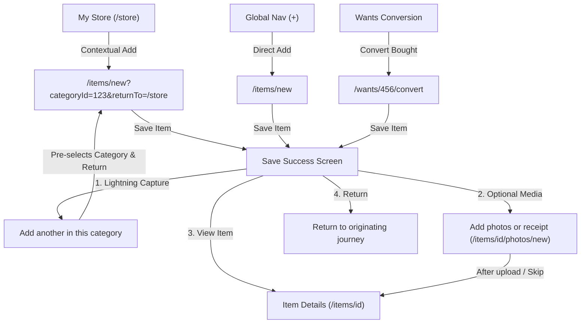

# Havefolio Product Capture Blueprint

Status: **Sprint Blueprint & Design Contract**  
Ticket: **PER-74**  
Parent: **PER-70**  
Implementation Children: **PER-71, PER-72, PER-73, PER-77, PER-78, PER-79, PER-80, PER-86**  

---

## 1. Capture Philosophy & Invariants

Havefolio is an anti-consumerism, private personal inventory and decision aid. Item capture must feel **lightweight, calm, and instantaneous**, not like an exhaustive e-commerce cataloging chore or an enterprise inventory audit.

### Non-Negotiable Invariants
1. **Manual Entry Always Works:** An owner must be able to add an item with just a keyboard, offline or online, without mandatory photo, scan, enrichment, or barcode lookup.
2. **True Minimum Path:** Item creation requires only an **Item Name**. Price and Date are strongly encouraged but gracefully allow "Unknown" toggles. Everything else is purely optional.
3. **Exact Financial & Date Precision:** Money is stored as integer minor units with ISO 4217 currency codes (e.g., INR minor units = paise; ₹899.00 = `"89900"`). Date precision is preserved (`exact`, `month`, `year`, `unknown`) rather than inventing days or recalculating historical values.
4. **Draft Protection & Crash Resilience:** In-progress data is preserved locally with owner consent. A network drop, server error, or accidental tab switch must never wipe entered work.
5. **No Marketplace Pressures:** No urgency indicators, streak counters, buy buttons, or valuation estimates.

---

## 2. Progressive Capture Anatomy

```
┌─────────────────────────────────────────────────────────────┐
│ 1. MINIMUM REQUIRED CORE (Visible immediately)              │
│    • Item Name * (autofocused, 1–300 chars)                 │
│    • Amount Paid & Currency (or [✓] Price unknown)          │
│    • Purchase Date (Exact / Month / Year / [✓] Date unknown)│
├─────────────────────────────────────────────────────────────┤
│ 2. CONTEXTUAL METADATA (Pre-filled if entered from route)   │
│    • Category & Subcategory (auto-selected from context)    │
│    • Purchase Merchant & Optional Link                      │
├─────────────────────────────────────────────────────────────┤
│ 3. PROGRESSIVE DISCLOSURE ("Additional details")            │
│    ▼ [Chevron] Additional details (optional)                │
│      • Tags (multiselect combobox)                          │
│      • Brand & Model / Variant                              │
│      • Acquisition Type (Bought new, Gift, Used, Other)     │
│      • Condition (Working, Needs repair, Broken, Worn out)  │
│      • Usage Frequency (Often, Sometimes, Rarely, Never)    │
│      • Private Notes & Serial Number                        │
├─────────────────────────────────────────────────────────────┤
│ 4. ACTIONS                                                  │
│    [ Save item (Primary) ]  [ Cancel / Return to journey ]  │
└─────────────────────────────────────────────────────────────┘
```

### Field-by-Field Rules

| Field | Requirement | Input Control | Default / Pre-fill | Precision & Validation Rules |
|---|---|---|---|---|
| **Item Name** | **Required** | Text Input | Empty (autofocused) | 1–300 characters. Trimmed. Plain text only. |
| **Price Paid** | Optional (or toggle unknown) | Number/Currency Input + Checkbox | Owner preference currency (e.g., INR) | Stored as integer minor units (`pricePaidMinor`). Cannot be negative. Zero is permitted (e.g., free items). If "Price unknown" is checked, amount field is disabled and value is stored as `null`. |
| **Purchase Date** | Optional (or toggle unknown) | DateInput / Selects + Checkbox | Current year or empty | Three explicit precisions supported: `exact` (YYYY-MM-DD), `month` (YYYY-MM), `year` (YYYY), or `unknown`. Day validation respects leap years via `daysInMonth(y, m)`. Never invent a day if unknown. |
| **Category** | Optional | Select / Combobox | Pre-filled if entered via `/store?categoryId=...` | Must belong to active owner categories. Subcategory requires parent category. |
| **Merchant** | Optional | Select / Combobox / Input | Pre-filled if entered via `/settings/merchants?merchantId=...` | Normalized merchant ID or new merchant creation. |
| **Acquisition** | Optional | Select (`ItemAcquisition`) | `'bought'` (or `'unknown'`) | Enum: `bought`, `gift`, `secondhand`, `other`, `unknown`. **Fix PER-73:** Stored in state and sent on save even if disclosure is collapsed! |
| **Condition** | Optional | Select (`ItemCondition`) | `'working'` | Enum: `working`, `needs_repair`, `broken`, `worn_out`, `unknown`. **Fix PER-73:** Preserved on collapse. |
| **Frequency** | Optional | Select (`ItemFrequency`) | `'often'` | Enum: `often`, `sometimes`, `rarely`, `never`, `unknown`. **Fix PER-73:** Preserved on collapse. |
| **Brand & Model**| Optional | Text Inputs | Empty | Up to 300 characters each. Optional hardware/product metadata. |
| **Private Notes**| Optional | Textarea | Empty | Up to 10,000 characters. Private to owner. |

---

## 3. Capture Journeys & Contextual Flow Matrix



### Detailed Journey Specifications

#### Journey 1: Lightning Category Capture (`/store` -> `/items/new`)
1. **Context Handshake:**
   - Owner is browsing the "Kitchen" category in My Store.
   - Owner clicks **"+ Add in Kitchen"** or an empty subcategory tile.
   - URL navigates to: `/items/new?categoryId=00000000-0000-4000-a036-000000000010&returnTo=/store%3Fcategory%3Dkitchen`.
2. **Form Presentation:**
   - "Category" is automatically set to "Kitchen" with a visual pill: *"Adding to Kitchen"*.
   - Name input is autofocused.
   - Cancel button reads: *"Cancel and return to Kitchen"*.
3. **Submission & Multi-Add Loop:**
   - On save, item is written to database via `POST /api/v1/items`.
   - Success view displays:
     - **[ + Add another item in Kitchen ]** (Primary action for rapid multi-item entry; preserves category and `returnTo`).
     - **[ Add photos or receipt ]** (Secondary action).
     - **[ Return to Kitchen in My Store ]** (Tertiary action returning immediately to the filtered catalog).

#### Journey 2: Direct Global Add (`Top Rail / Mobile Nav` -> `/items/new`)
1. **Context Handshake:**
   - Owner clicks "+ Add item" from global navigation.
   - URL: `/items/new`.
2. **Form Presentation:**
   - Clean, left-pinned form (`max-w-2xl`).
   - Category selector is empty with placeholder *"Select a category (optional)"*.
3. **Success Actions (Fix PER-71):**
   - Success card displays confirmation badge with item name and saved price.
   - **Corrected Action Links:**
     - **"Add photos or receipt"** -> `/items/${item.id}/photos/new?returnTo=/items/${item.id}`
     - **"Edit full item"** -> `/items/${item.id}?edit=true` (Opens item edit dialog; **NO 404!**)
     - **"View item details"** -> `/items/${item.id}`
     - **"Add another item"** -> Resets form for next possession.

#### Journey 3: Wants Impulsive Purchase Conversion (`/wants/[id]/convert`)
1. **Context Handshake:**
   - Owner completes a 30-day waiting period for a desire (e.g., "Espresso Machine") and decides to buy it.
   - On the Want details or history screen, owner clicks **"Mark as bought and add to inventory"**.
   - URL: `/wants/${desireId}/convert`.
2. **Form Presentation:**
   - Name pre-filled with desire title (`"Espresso Machine"`).
   - Price pre-filled with desire target price and currency.
   - Purchase Date defaults to today's date.
   - Merchant pre-selected if recorded in the desire.
3. **Execution:**
   - Calls `POST /api/v1/desires/${desireId}/convert`.
   - Atomically creates the owned item and transitions desire status to `bought`.
   - Directly offers: *"Espresso Machine is now in your inventory. Would you like to upload a photo of it or the receipt?"*

#### Journey 4: Media Continuation Handoff (`/items/[id]/photos/new`)
1. **Design Rule:** Photo and document capture is **strictly an optional continuation**, never a prerequisite for item creation.
2. **Handoff Contract:**
   - Accessible via `/items/${itemId}/photos/new?returnTo=${encodeURIComponent(returnTo)}`.
   - Displays clear breadcrumb: `[Back to Item] / Add photo or receipt`.
   - Offers native camera capture on mobile devices (`capture="environment"`) or desktop file drag-and-drop.
   - Supports JPEG, PNG, WebP, and client-side HEIC-to-JPEG conversion.
   - If connection drops or upload fails:
     - Local image preview remains intact.
     - Item record is **already safely persisted** in database.
     - Displays explicit **"Retry upload"** and **"Skip for now"** buttons.

---

## 4. Defect Remedies & Implementation Instructions

### Remedy for PER-71: Fix Add Item Success Edit Link
In `apps/web/components/add-item-form.tsx`:
- **Current Broken Code:**
  ```tsx
  <Button asChild variant="outline" className="min-h-11">
    <Link href={`/items/${createdItem.id}/edit`}>
      <FileEdit className="mr-2 size-4" aria-hidden="true" />
      Add details
    </Link>
  </Button>
  ```
- **Approved Replacement:**
  ```tsx
  <Button asChild variant="outline" className="min-h-11">
    <Link href={`/items/${createdItem.id}?edit=true`}>
      <FileEdit className="mr-2 size-4" aria-hidden="true" />
      Edit item details
    </Link>
  </Button>
  ```
  And in `apps/web/components/item-details.tsx`, inspect `searchParams.get('edit') === 'true'` on mount to automatically open `ItemEditDialog`.

### Remedy for PER-72: Accessible Validation Summary Targeting
In `apps/web/components/add-item-form.tsx`:
1. Ensure every error key in `errors` maps to an element ID that actually exists in the DOM:
   - `name` -> `${formId}-name` (Input)
   - `price` -> `${formId}-price` (Input)
   - `date` -> `${formId}-exact-date` (when exact) or `${formId}-year` (when year/month)
   - `category` -> `${formId}-category-trigger` (SelectTrigger)
   - `purchaseUrl` -> `${formId}-purchase-url` (Input)
2. In the error summary click handler:
   ```tsx
   onClick={(e) => {
     e.preventDefault();
     const optionalKeys = ['brand', 'model', 'acquisition', 'condition', 'frequency', 'description', 'notes'];
     if (optionalKeys.includes(key) && !showOptionalDetails) {
       setShowOptionalDetails(true);
       // Allow React render tick to mount the inputs
       setTimeout(() => {
         const el = document.getElementById(`${formId}-${key}`);
         el?.focus();
         el?.scrollIntoView({ behavior: 'smooth', block: 'center' });
       }, 50);
       return;
     }
     const el = document.getElementById(`${formId}-${key}`);
     el?.focus();
     el?.scrollIntoView({ behavior: 'smooth', block: 'center' });
   }}
   ```

### Remedy for PER-73: Preserve Selected Metadata on Collapse
In `apps/web/components/add-item-form.tsx`:
- **Current Flawed Code:**
  ```tsx
  acquisitionType: showOptionalDetails ? acquisitionType : undefined,
  condition: showOptionalDetails ? condition : undefined,
  useFrequency: showOptionalDetails ? useFrequency : undefined,
  ```
- **Approved Replacement:**
  ```tsx
  acquisitionType: acquisitionType || undefined,
  condition: condition || undefined,
  useFrequency: useFrequency || undefined,
  ```
  The visual disclosure state `showOptionalDetails` controls only UI visibility, never data payload validity.

---

## 5. Draft Persistence & Crash Recovery

1. **Storage Mechanism:** Client-side `localStorage` keyed by `havefolio:item-draft:${ownerId}`.
2. **Debounced Autosave:** Form updates are saved to `localStorage` 500ms after typing stops (`saveItemDraft`).
3. **Clearance Trigger:** The draft is deleted **only upon successful HTTP 201 response** from `createItem()`.
4. **Resilience on Error:** If `createItem()` returns an HTTP 500/503 or network error:
   - Form inputs remain populated.
   - An alert message displays the failure reason.
   - The primary button offers **"Retry save"**.
   - If the user reloads or navigates away and returns, the draft is restored with a notification: *"Restored unsaved draft"*.
5. **Privacy Floor:** Draft storage stores only non-sensitive item attributes. Drafts expire automatically after 7 days of inactivity.
