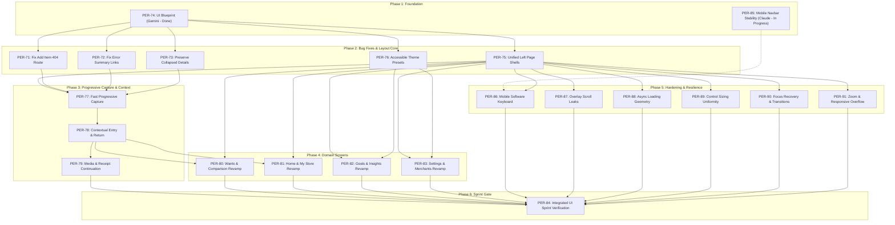

# Havefolio Design System & UI Revamp Blueprint

Status: **Accepted Foundation & UI Revamp Blueprint**  
Tickets: **PER-6, PER-70 (Sprint Parent), PER-74 (Design Contract & Audit)**  
Sprint Authority: **UI revamp sprint 2026-10-20. P1 — Sprint Priority.**  
Companion Architecture Artifacts:
- [Route & Capture Audit Matrix](file:///Users/harsh/Developer/Havefolio/docs/architecture/ui-route-audit.md)
- [Product Capture Blueprint](file:///Users/harsh/Developer/Havefolio/docs/architecture/capture-blueprint.md)
- [Responsive UI Wireframes](file:///Users/harsh/Developer/Havefolio/docs/architecture/ui-wireframes.md)
- [Control Standardisation Architecture](file:///Users/harsh/Developer/Havefolio/docs/architecture/control-standardisation.md)

---

## 1. Executive Summary & Sprint Authority

On 2026-10-20, the product owner authorized the **UI Revamp Sprint (PER-70)** to resolve user experience friction across Havefolio. Specifically:
1. **Unified Left Alignment:** Eliminate floating centered content islands (`mx-auto max-w-*`) across inventory screens so all pages line up predictably with the primary navigation shell.
2. **Fast, Effortless Capture:** Simplify item creation into a fast, progressive capture journey with seamless contextual returns (e.g. from My Store or Wants).
3. **Confirmed Sprint Bug Fixes:** Resolve three source-confirmed defects: missing edit route 404 (PER-71), broken validation summary links (PER-72), and metadata loss on collapsed disclosure (PER-73).
4. **Accessible Themes Exception:** The owner explicitly authorized curated appearance presets (**Neutral**, **Ocean**, **Forest**) that operate independently of **System / Light / Dark** mode, while preserving the existing UI libraries (`shadcn/ui`, `Kibo UI`, `Radix`, `Tailwind v4`). This dedicated authorization supersedes prior neutral-only restrictions strictly within reviewed theme scope.

This document serves as the **concrete design contract** governing implementation across all child tickets (PER-71 through PER-91).

---

## 2. Product Language & Invariants

Havefolio is a private personal inventory and decision aid designed to encourage mindful possession ownership and counter impulse consumerism. The interface must always feel **calm, neutral, and unhurried**:

- **No Marketplace Pressure:** Never introduce cart badges, checkout flows, fake scarcity countdowns, price drop alerts, or shopping streaks.
- **Warm, Non-Judgmental Tone:** Never shame users for purchases or classify their choices for them.
- **Exact Money & Minor Units:** Monetary values are stored as integer minor units with ISO 4217 currency codes (e.g., ₹2,499.00 = `"249900"` in `INR`). Catalogue prices are never substituted for actual price paid.
- **Preserved Date Precision:** Exact, month-only, year-only, and unknown precisions remain distinct; never invent a day when only month or year is known.
- **Manual Entry Supremacy:** Manual input must always succeed unconditionally. Optional enrichment (photos, barcodes, OCR) may assist but must never gate item creation.
- **Private Data Isolation:** Receipts, photos, and notes are encrypted and protected; never expose media URLs to public CDNs or browser telemetry.

---

## 3. Layout Architecture: The Unified Left Rail

### The Problem of Centered Content Islands
Prior to PER-74, pages used disparate container classes:
- Home & Add Item: `max-w-6xl mx-auto` (with inner form `max-w-xl mx-auto mb-6`)
- My Store: `max-w-[112rem] mx-auto`
- Goals & History: `max-w-3xl mx-auto`
- Settings & Merchants: `max-w-4xl mx-auto`
- Photo Gallery: `max-w-5xl mx-auto`

On desktop viewports (1280px to 1920px), navigating between routes caused the left edge of content to jump horizontally between seven different coordinates. Furthermore, the top search bar in `apps/web/app/(inventory)/layout.tsx` was pinned to `px-4 sm:px-6`, while page titles floated hundreds of pixels to the right.

### The Unified Left-Rail Contract
All inventory pages and shells must align to a **single, shared left rail**:

```
┌──────────────────┬────────────────────────────────────────────────────────────┐
│ Navigation Shell │ Header: [ 🔍 Search... (aligned with rail) ] [Theme Toggle]│
│                  ├────────────────────────────────────────────────────────────┤
│ (w-68 expanded   │ x = Left Rail                                              │
│  or w-16 icon    │ Page Title & Actions                                       │
│  or hidden       │                                                            │
│  on mobile)      │ ┌────────────────────────┐                                 │
│                  │ │ Form / Detail (max-w-2xl│ (Remaining area is calm       │
│                  │ │ pinned to left rail)   │  negative space or companion)   │
│                  │ └────────────────────────┘                                 │
│                  │                                                            │
│                  │ ┌────────────────────────────────────────────────────────┐ │
│                  │ │ Catalogs & Grids (expand up to max-w-7xl from left)    │ │
│                  │ └────────────────────────────────────────────────────────┘ │
└──────────────────┴────────────────────────────────────────────────────────────┘
```

### Breakpoint Geometry & Gutter Standards

| Breakpoint | Viewport Width | Sidebar State | Outer Gutter | Left Content Rail | Max Content Form Width | Max Grid Width |
|---|---|---|---|---|---|---|
| **Mobile** | `< 640 px` (360 px floor) | Hidden (bottom nav) | `px-4` (16 px) | `x = 16 px` | Full width (328 px) | Full width (1–2 cols) |
| **Tablet** | `640 px – 1023 px` (768 px) | Collapsed (`w-16`, 64 px) | `px-6` (24 px) | `x = 88 px` | `max-w-xl` (576 px, pinned left) | Responsive 2–3 cols |
| **Desktop** | `1024 px – 1439 px` | Expanded (`w-68`, 272 px)| `px-8` (32 px) | `x = 304 px` | `max-w-2xl` (672 px, pinned left) | `max-w-6xl` (1152 px) |
| **Wide** | `≥ 1440 px` (1512 px standard) | Expanded (`w-68`, 272 px)| `px-8` (32 px) | `x = 304 px` | `max-w-2xl` (672 px, pinned left) | `max-w-7xl` (1280 px) |

### Page-Shell Rules
1. **No `mx-auto` on Page Wrappers:** Replace `<main className="mx-auto ...">` with `<main className="w-full px-4 sm:px-6 lg:px-8 py-6 sm:py-8">`.
2. **Left-Pinned Forms:** Constrain form containers to `max-w-2xl` (672 px) for ergonomic line length (50–75 characters per line), but **never center them**. Keep them anchored to the left content rail.
3. **Wide Catalog Grids:** In My Store, Wants, and Insights, allow grids to fill available width up to `max-w-7xl` using auto-fill columns (`repeat(auto-fill, minmax(15rem, 1fr))`).

> **Implemented in PER-75:** see [Shared left-rail page shell](architecture/page-shell.md) for the shipped `PageShell` widths and the recorded differences from this table (sidebar state is a saved preference at any desktop width; My Store keeps its 112rem cap).

---

## 4. Mobile Navigation & Clearance Contract (PER-85 Coordination)

Claude owns **PER-85** (`app-navigation.tsx`, safe-area mobile clearance, and navigation CSS). To ensure non-blocking parallel work, this blueprint defines the agreed clearance contract:

1. **Floating Mobile Navbar Geometry:**
   - Position: `fixed inset-x-3 bottom-3 z-50`
   - Height: 56 px control button (`h-14`) + 12 px padding (`p-1.5`) + 2 px borders = **70 px total height**.
2. **Provisional Page Bottom Clearance:**
   - All mobile pages must reserve bottom padding to prevent content, sticky actions, or active inputs from being hidden behind the navbar.
   - Standard clearance class: `pb-28` (112 px) or `pb-[calc(env(safe-area-inset-bottom,0px)+5.5rem)]`.
   - On desktop (`md:`), reset to `md:pb-0`.
> **Superseded by the merged PER-85 CSS:** the clearance above was provisional. The implemented contract is `--mobile-nav-clearance` in `apps/web/app/globals.css`, applied once by the inventory layout; pages must not add `pb-28`.

3. **Software Keyboard Usability (PER-86):**
   - Save and cancel buttons on mobile forms must remain reachable above the software keyboard using standard viewport scrolling.

---

## 5. System Typography, Spacing & Control Standards

### Typography Scale (System Fonts)
Havefolio uses the native operating system typography stack (`font-sans`) without external font downloads:

| Role | Tailwind Classes | Size / Line-Height | Weight | Usage |
|---|---|---|---|---|
| **Page H1** | `text-2xl sm:text-3xl tracking-tight` | 24 px / 32 px (sm: 30 px / 36 px) | Bold (700) | Single page heading, left-aligned |
| **Section H2** | `text-lg sm:text-xl tracking-tight` | 18 px / 28 px (sm: 20 px / 28 px) | Semibold (600) | Card group, section heading |
| **Card H3** | `text-base` | 16 px / 24 px | Semibold (600) | Card title, disclosure header |
| **Body (Default)** | `text-sm leading-6` | 14 px / 24 px | Regular (400) | Form fields, labels, specs |
| **Muted / Hint** | `text-xs leading-5 text-muted-foreground` | 12 px / 20 px | Regular (400) | Helper hints, timestamps, metadata |
| **Financial / Metric** | `font-semibold tabular-nums` | Inherited or `text-lg` | Semibold (600) | Currency amounts, item counts |

### Spacing Scale
- Component internals: `space-y-1.5` (6 px) or `space-y-2` (8 px)
- Form field groups: `space-y-4` (16 px) or `gap-3` (12 px)
- Card / Section spacing: `space-y-6` (24 px)
- Page top/bottom gutters: `py-6 sm:py-8` (24 px / 32 px)

### Control Sizing & Accessibility Floor
- **Minimum Touch Target:** `44 × 44 px` (`min-h-11`) for all visible buttons, inputs, selects, and disclosure toggles on touch viewports.
- **Input Heights:** `h-11` (44 px) default across text inputs, selects, and buttons.
- **Focus Indicators:** Uncompromised `ring-2 ring-ring ring-offset-2 ring-offset-background` on `:focus-visible`. Never suppress focus outlines.
- **Detailed Specification:** See [Control Standardisation Architecture](file:///Users/harsh/Developer/Havefolio/docs/architecture/control-standardisation.md) (PER-89) for the complete component usage matrix, state contracts, and touch target rules.

---

## 6. Color Palette & Theme Specification

### Orthogonal 2D Theme Architecture
Havefolio decouples **Luminance Mode** (`light`, `dark`, `system`) from **Palette Preset** (`neutral`, `ocean`, `forest`). A user can select any combination (e.g. *Ocean Dark*, *Forest Light*, *Neutral System*).

- **Luminance Mode:** Managed by `next-themes` via the `class` attribute on `<html>` (`html.dark` or light). In `system` mode, it dynamically resolves and synchronizes with operating system preference changes (`prefers-color-scheme`) without altering the selected palette preset.
- **Palette Preset:** Managed by `PaletteProvider` and `usePalette()` via the `data-palette` attribute on `<html>` (`html[data-palette="neutral"]`, `html[data-palette="ocean"]`, `html[data-palette="forest"]`).
- **Appearance Settings Control:** The user configures appearance in `/settings` via independent display mode (System, Light, Dark) and palette preset (Neutral, Ocean, Forest) radio groups with live styled swatch previews, full keyboard navigation, screen reader descriptions, and non-sensitive privacy guarantees.

```
                    ┌───────────────┐
                    │ System / Auto │
                    └───────┬───────┘
                            │ (Resolves to OS preference)
           ┌────────────────┴────────────────┐
           ▼                                 ▼
    ┌──────────────┐                  ┌──────────────┐
    │  Light Mode  │                  │  Dark Mode   │
    └──────┬───────┘                  └──────┬───────┘
           │                                 │
   ┌───────┼───────┐                 ┌───────┼───────┐
   ▼       ▼       ▼                 ▼       ▼       ▼
Neutral  Ocean  Forest            Neutral  Ocean  Forest
```

### Zero-Flash Client Bootstrapping
To prevent incorrect-theme flashing (FOUC) or React 19 hydration mismatches:
1. An inline execution script (`paletteBootstrap`) is embedded in `<head>` in `apps/web/app/layout.tsx` before paint.
2. The script runs synchronously, checks `localStorage` under `havefolio:palette-preset:v1` (with fallback to `havefolio:palette-preset`), validates the value against the bounded preset list (`neutral`, `ocean`, `forest`), and immediately sets `document.documentElement.setAttribute('data-palette', preset)`.
3. If storage is unavailable (e.g. private browsing mode), throws an exception, or contains corrupted/obsolete data, it safely defaults to `'neutral'`.

### Persistence, Safety & Cross-Tab Synchronization
- **Storage Key:** `havefolio:palette-preset:v1` (with read fallback to legacy `havefolio:palette-preset`).
- **Bounded Validation:** All inputs from storage or user selection pass through strict allowlist validation (`isPalettePreset` / `parsePalette`). Non-matching strings, null, undefined, or unexpected types resolve to `'neutral'`.
- **Exception Resilience:** All storage access is guarded with `try / catch` blocks to gracefully handle `QuotaExceededError`, disabled cookies/storage, or sandboxed environments without throwing or crashing the UI.
- **Key Isolation:** The palette provider strictly touches only its dedicated preference key and never modifies, clears, or interferes with other user preferences such as density (`havefolio:density-preset:v1`), sidebar state (`havefolio:sidebar-collapsed:v1`), or capture drafts (`havefolio:capture-draft:v1`).
- **Cross-Tab Synchronization:** `PaletteProvider` listens to `window.addEventListener('storage', ...)` so changing the palette or mode in one tab updates all other open Havefolio tabs in real time.

### Palette Tokens & Concrete Contrast Proofs (OKLCH)

All values are specified in OKLCH within `packages/ui/src/styles/themes.css` and verified using WCAG 2.1 relative luminance formulas (`apps/web/test/theme-contrast.test.tsx`) for WCAG 2.1 AA (≥ 4.5:1 text, ≥ 3.0:1 UI) and WCAG AAA (≥ 7.0:1 text):

#### 1. Neutral Palette (Zinc Baseline)
- **Light (`[data-palette="neutral"]` / default):**
  - Background: `oklch(1 0 0)` (#ffffff)
  - Foreground: `oklch(0.145 0 0)` (#18181b) — **Contrast: 19.79:1 (AAA)**
  - Muted: `oklch(0.97 0 0)` | Muted Foreground: `oklch(0.556 0 0)` (#71717a) — **Contrast: 4.73:1 (AA)**
  - Primary: `oklch(0.205 0 0)` (#18181b) | Primary FG: `oklch(0.985 0 0)` (#fafafa) — **Contrast: 16.20:1 (AAA)**
  - Secondary: `oklch(0.97 0 0)` | Secondary FG: `oklch(0.205 0 0)` — **Contrast: 15.00:1 (AAA)**
  - Border: `oklch(0.922 0 0)` (#e4e4e7) | Input: `oklch(0.922 0 0)`
  - Ring / Sidebar-Ring: `oklch(0.556 0 0)` — **Contrast: 4.73:1 (≥ 3.0:1 UI focus requirement met)**
  - Charts:
    - `--chart-1`: `oklch(0.646 0.222 41.116)` (amber/orange)
    - `--chart-2`: `oklch(0.6 0.118 184.704)` (teal)
    - `--chart-3`: `oklch(0.398 0.07 227.392)` (navy)
    - `--chart-4`: `oklch(0.828 0.189 84.429)` (gold)
    - `--chart-5`: `oklch(0.769 0.188 70.08)` (peach)
- **Dark (`.dark [data-palette="neutral"]` / `.dark`):**
  - Background: `oklch(0.145 0 0)` (#09090b)
  - Foreground: `oklch(0.985 0 0)` (#fafafa) — **Contrast: 18.96:1 (AAA)**
  - Muted: `oklch(0.269 0 0)` | Muted Foreground: `oklch(0.708 0 0)` (#a1a1aa) — **Contrast: 7.63:1 (AAA)**
  - Primary: `oklch(0.922 0 0)` (#e4e4e7) | Primary FG: `oklch(0.205 0 0)` (#18181b) — **Contrast: 14.22:1 (AAA)**
  - Secondary: `oklch(0.269 0 0)` | Secondary FG: `oklch(0.985 0 0)` — **Contrast: 11.23:1 (AAA)**
  - Border: `oklch(1 0 0 / 10%)` | Input: `oklch(1 0 0 / 15%)`
  - Ring / Sidebar-Ring: `oklch(0.708 0 0)` — **Contrast: 4.18:1 (≥ 3.0:1 UI focus requirement met)**
  - Charts:
    - `--chart-1`: `oklch(0.488 0.243 264.376)` (indigo)
    - `--chart-2`: `oklch(0.696 0.17 162.48)` (emerald)
    - `--chart-3`: `oklch(0.769 0.188 70.08)` (peach)
    - `--chart-4`: `oklch(0.627 0.265 303.9)` (purple)
    - `--chart-5`: `oklch(0.645 0.246 16.439)` (rose)

#### 2. Ocean Palette (Marine Slate)
- **Light (`[data-palette="ocean"]`):**
  - Background: `oklch(0.985 0.008 230)` (#f5fbff)
  - Foreground: `oklch(0.16 0.03 235)` (#010f18) — **Contrast: 18.58:1 (AAA)**
  - Muted: `oklch(0.94 0.02 230)` | Muted Foreground: `oklch(0.48 0.04 235)` (#476271) — **Contrast: 6.21:1 (AA)**
  - Primary: `oklch(0.28 0.07 235)` (#002d46) | Primary FG: `oklch(0.985 0.005 230)` (#f7fbfd) — **Contrast: 13.73:1 (AAA)**
  - Secondary: `oklch(0.94 0.02 230)` | Secondary FG: `oklch(0.20 0.05 235)` — **Contrast: 13.43:1 (AAA)**
  - Border: `oklch(0.90 0.015 230)` (#d5e0e6) | Input: `oklch(0.90 0.015 230)`
  - Ring / Sidebar-Ring: `oklch(0.48 0.04 235)` — **Contrast: 6.19:1 (≥ 3.0:1 UI focus requirement met)**
  - Charts:
    - `--chart-1`: `oklch(0.55 0.16 235)` (deep cyan/slate)
    - `--chart-2`: `oklch(0.65 0.14 200)` (caribbean teal)
    - `--chart-3`: `oklch(0.42 0.12 250)` (marine navy)
    - `--chart-4`: `oklch(0.72 0.12 170)` (seafoam)
    - `--chart-5`: `oklch(0.60 0.10 280)` (deep lavender)
- **Dark (`.dark[data-palette="ocean"]` / `.dark [data-palette="ocean"]`):**
  - Background: `oklch(0.14 0.03 235)` (#000b14)
  - Foreground: `oklch(0.97 0.01 230)` (#eff7fb) — **Contrast: 18.26:1 (AAA)**
  - Muted: `oklch(0.24 0.04 235)` | Muted Foreground: `oklch(0.72 0.03 230)` (#92a9b4) — **Contrast: 8.07:1 (AAA)**
  - Primary: `oklch(0.80 0.08 225)` (#84c9e5) | Primary FG: `oklch(0.15 0.04 235)` (#000d19) — **Contrast: 10.69:1 (AAA)**
  - Secondary: `oklch(0.24 0.04 235)` | Secondary FG: `oklch(0.95 0.01 230)` — **Contrast: 12.72:1 (AAA)**
  - Border: `oklch(0.26 0.03 235)` (#152631) | Input: `oklch(0.26 0.03 235)`
  - Ring / Sidebar-Ring: `oklch(0.60 0.08 230)` — **Contrast: 6.27:1 (≥ 3.0:1 UI focus requirement met)**
  - Charts:
    - `--chart-1`: `oklch(0.70 0.14 225)` (bright cyan)
    - `--chart-2`: `oklch(0.75 0.12 195)` (light turquoise)
    - `--chart-3`: `oklch(0.62 0.15 255)` (azure)
    - `--chart-4`: `oklch(0.80 0.10 165)` (mint teal)
    - `--chart-5`: `oklch(0.72 0.12 285)` (periwinkle)

#### 3. Forest Palette (Sage & Cedar Pine)
- **Light (`[data-palette="forest"]`):**
  - Background: `oklch(0.985 0.01 145)` (#f6fcf6)
  - Foreground: `oklch(0.16 0.03 145)` (#051106) — **Contrast: 18.57:1 (AAA)**
  - Muted: `oklch(0.94 0.02 145)` | Muted Foreground: `oklch(0.47 0.04 145)` (#4d614d) — **Contrast: 6.44:1 (AA)**
  - Primary: `oklch(0.27 0.06 145)` (#112e13) | Primary FG: `oklch(0.985 0.005 145)` (#f8fbf8) — **Contrast: 14.18:1 (AAA)**
  - Secondary: `oklch(0.94 0.02 145)` | Secondary FG: `oklch(0.20 0.05 145)` — **Contrast: 13.57:1 (AAA)**
  - Border: `oklch(0.90 0.015 145)` (#d8e1d8) | Input: `oklch(0.90 0.015 145)`
  - Ring / Sidebar-Ring: `oklch(0.45 0.06 145)` — **Contrast: 6.93:1 (≥ 3.0:1 UI focus requirement met)**
  - Charts:
    - `--chart-1`: `oklch(0.52 0.14 145)` (moss green)
    - `--chart-2`: `oklch(0.62 0.13 110)` (olive sage)
    - `--chart-3`: `oklch(0.40 0.10 170)` (pine spruce)
    - `--chart-4`: `oklch(0.70 0.15 85)` (warm ochre)
    - `--chart-5`: `oklch(0.58 0.12 130)` (fern leaf)
- **Dark (`.dark[data-palette="forest"]` / `.dark [data-palette="forest"]`):**
  - Background: `oklch(0.14 0.025 145)` (#040c04)
  - Foreground: `oklch(0.97 0.01 145)` (#f1f7f1) — **Contrast: 18.26:1 (AAA)**
  - Muted: `oklch(0.24 0.035 145)` | Muted Foreground: `oklch(0.72 0.03 145)` (#99aa99) — **Contrast: 8.10:1 (AAA)**
  - Primary: `oklch(0.78 0.09 145)` (#93c794) | Primary FG: `oklch(0.15 0.04 145)` (#020f02) — **Contrast: 10.11:1 (AAA)**
  - Secondary: `oklch(0.24 0.035 145)` | Secondary FG: `oklch(0.95 0.01 145)` — **Contrast: 12.87:1 (AAA)**
  - Border: `oklch(0.26 0.025 145)` (#1c271d) | Input: `oklch(0.26 0.025 145)`
  - Ring / Sidebar-Ring: `oklch(0.58 0.09 145)` — **Contrast: 6.34:1 (≥ 3.0:1 UI focus requirement met)**
  - Charts:
    - `--chart-1`: `oklch(0.72 0.14 145)` (bright sage)
    - `--chart-2`: `oklch(0.76 0.13 115)` (lime olive)
    - `--chart-3`: `oklch(0.65 0.12 175)` (pale pine)
    - `--chart-4`: `oklch(0.80 0.14 88)` (amber gold)
    - `--chart-5`: `oklch(0.70 0.12 135)` (leaf green)

### Preservation of Non-Color Status Cues (WCAG 1.4.1)
Theme presets strictly preserve non-color cues across all components:
- Status badges and pills accompany semantic colors with explicit text labels (e.g. "Active", "Archived", "Wishlist", "Refunded") and distinct icons.
- Validation and error messages include inline warning/error icons (`AlertCircle`, `XCircle`) and textual failure explanations.
- Selected radio options and tabs feature solid borders, filled inner indicators, and checkmarks in addition to background color shifts.

---

## 7. Component Sourcing & Registry Strategy

Havefolio strictly reuses vetted registry components behind `packages/ui`. Do not invent custom UI primitives when approved components exist:

1. **shadcn/ui Primitives:** Button, Input, Select, Checkbox, RadioGroup, Dialog, AlertDialog, DropdownMenu, Tooltip, Skeleton, Card, Badge, Table, Textarea, Switch, Separator.
2. **Kibo UI Primitives:** Pill (`packages/ui/src/components/kibo-ui/pill`).
3. **Havefolio Compositions:** DateInput (`date-input.tsx`), OwnedItemCard (`owned-item-card.tsx`), ItemCover (`item-cover.tsx`), PrivatePhoto (`private-photo.tsx`).
4. **Icons:** `lucide-react` (standard icon size: `size-4` in controls, `size-5` in navigation).

---

## 8. Non-Circular Implementation & Ownership Plan

To allow the three implementation agents to work in parallel without merge conflicts or circular blockers, the child tickets are phased as follows:



### Ownership Boundaries
- **Gemini (Documentation & Blueprint):** Owns `docs/design-system.md`, `docs/architecture/ui-route-audit.md`, `docs/architecture/capture-blueprint.md`, and `docs/architecture/ui-wireframes.md`. Does not touch runtime code or CSS in PER-74.
- **Claude (Mobile Navigation):** Owns `app-navigation.tsx`, inventory layout mobile clearance, narrowly necessary mobile CSS, and navigation tests in PER-85.
- **Implementation Agents (Subsequent Tickets):** Consume this contract to deliver PER-75 through PER-91 sequentially according to the dependency graph above.
